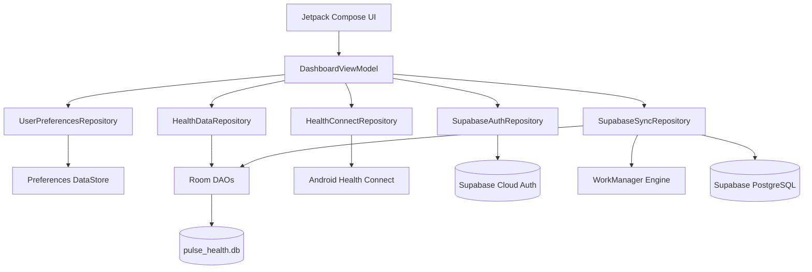
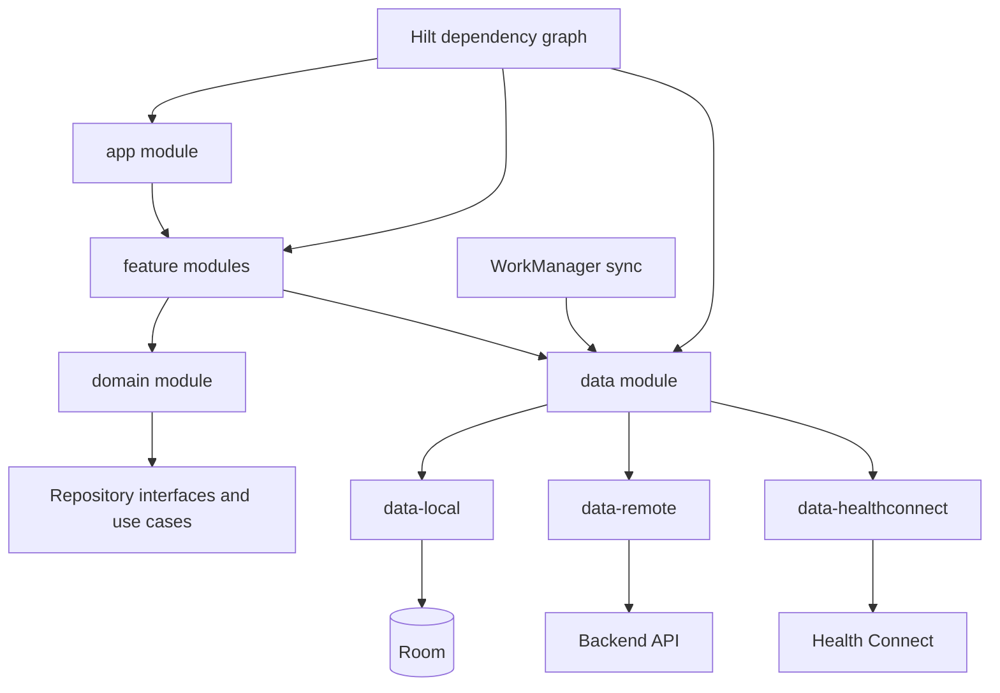
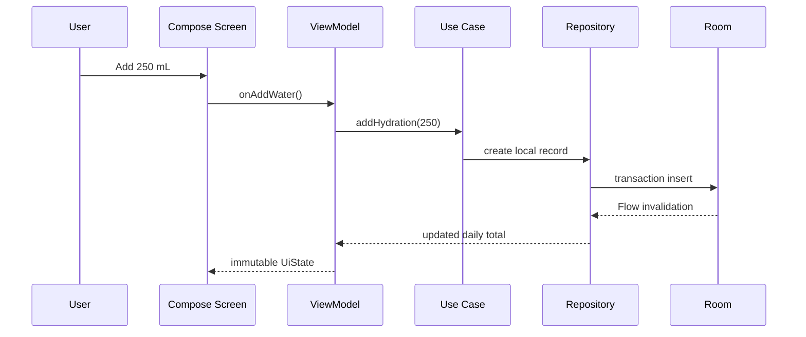
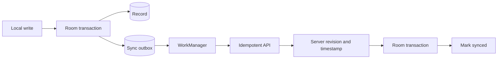

# Architecture

## 1. Scope

This document describes both the architecture currently present in the repository and the target architecture required for a production service. Sections are explicitly labeled to prevent planned components from being mistaken for implemented code.

## 2. Current architecture

The current app is a single Android application module with manual dependency construction.



### Current layers

| Layer | Location | Responsibility |
|---|---|---|
| Application | `PulseHealthApplication.kt` & `di/AppContainer.kt` | Application process entry point and dependency container |
| Activity | `MainActivity.kt` | Edge-to-edge Compose host |
| Presentation | `ui/` | Composables, modular components, theme and `DashboardViewModel` |
| Domain models | `data/HealthModels.kt` | Dashboard state, time range and metric values |
| Local repository | `data/HealthDataRepository.kt` | Hydration validation and day-boundary logic |
| Preferences | `data/UserPreferencesRepository.kt` | Hidden favorite-card IDs and water goals |
| Health integration | `data/HealthConnectRepository.kt` | Availability, permissions, period aggregations and writes |
| Authentication | `data/SupabaseAuthRepository.kt` | Supabase auth client with EncryptedSharedPreferences (Keystore) |
| Sync Engine | `data/sync/SupabaseSyncRepository.kt` | Two-way idempotent Room outbox sync and WorkManager scheduling |
| Notifications | `notifications/` | Opt-in local reminders, quiet hours, actionable quick-add receiver and WorkManager scheduler |
| Sharing | `data/SharingRepository.kt` | Granular recipient authorizations, expiry policies and sanitized report export |
| Database | `data/local/` | Room database, entities and DAOs |

### Current limitations

- `PulseHealthApp.kt` contains multiple screens and components in one large file.
- Navigation is state-based rather than a route graph despite Navigation Compose being included.
- Repositories are instantiated directly inside the ViewModel.
- No dependency injection, use-case layer, backend client, authenticated session or background sync exists.
- Dashboard state mixes real, local and demo values.
- `DailyHealthSummaryEntity` is defined but not yet wired into the dashboard.

## 3. Target Android architecture

Adopt a modular, offline-first architecture incrementally. Do not perform a large rewrite solely to match this diagram.



Suggested modules when complexity justifies them:

```text
:app
:core:model
:core:designsystem
:core:database
:core:network
:core:healthconnect
:core:testing
:feature:onboarding
:feature:summary
:feature:hydration
:feature:activity
:feature:profile
:feature:auth
:sync
```

Remain in a single module until at least two features need the same boundary. Package-by-feature is an acceptable intermediate step.

## 4. State and data flow

Use unidirectional data flow:



Rules:

- UI emits events and renders immutable state.
- ViewModels coordinate use cases; they do not contain SQL or HTTP logic.
- Repositories define the source-of-truth policy.
- Room is the source of truth for user-created and synchronized records.
- Network and Health Connect results are persisted before being treated as durable state.
- One-shot effects such as navigation or permission launch must not be stored as permanent state.

## 5. Source-of-truth policy

| Data | Primary source | Cache/secondary source |
|---|---|---|
| Manual hydration | Room | Optional backend after sync |
| Favorites/settings | DataStore | Optional account settings later |
| Health Connect records | Health Connect | Normalized daily summaries in Room |
| Auth session | Secure credential store | Backend token service |
| Cloud account/profile | Backend | Room cache |
| UI demo values | Development/demo mode only | Never merge with real totals |

Unknown data must be represented as unknown/null, not as zero. Demo data must be visibly labeled or restricted to previews/demo builds.

## 6. Synchronization design (planned)

Use an outbox-based offline-first protocol.



Requirements:

- Client-generated UUID is the idempotency key.
- Every mutable record has `updatedAt`, optional `deletedAt`, `serverRevision` and sync state.
- Deletes use tombstones until all relevant clients acknowledge them.
- Server time is authoritative for revisions; device time remains the event timestamp.
- Retry transient failures with exponential backoff and jitter.
- Authentication errors suspend sync until the session refreshes.
- Permanent validation conflicts surface to the user or a diagnostics screen.

## 7. Authentication architecture (planned)

Provider selection must be recorded in an ADR before implementation. Regardless of provider:

- Keep provider SDKs behind an `AuthRepository` interface.
- Expose `AuthState` as a process-safe `StateFlow`.
- Store refresh credentials using platform-backed secure storage, never plain DataStore.
- Backend authorizes every resource by authenticated user ID; never accept a client-supplied user ID as authority.
- Support local-only mode without fake authentication.

## 8. Navigation

Target route groups:

```text
onboarding/*
auth/*
summary
metric/{metricType}
hydration/history
sharing
browse
profile
settings/privacy
settings/notifications
```

Use typed routes where supported. Deep links must validate inputs and must not expose private health values in URLs.

## 9. Background work

Use WorkManager for deferrable synchronization and reminder scheduling. Constraints:

- Unique work names per account and operation class.
- Network constraint for cloud sync.
- Backoff on transient errors.
- Cancel account-scoped work on sign-out or deletion.
- Avoid reading Health Connect in the background without the required permission and policy justification.

## 10. Architecture decision records

Create `docs/adr/NNNN-title.md` when deciding:

- authentication/backend provider;
- cloud database and hosting;
- dependency injection framework;
- module split;
- encryption-at-rest approach;
- analytics/crash provider;
- conflict-resolution strategy.

ADR template:

```markdown
# NNNN: Decision title
Status: proposed | accepted | superseded
Date: YYYY-MM-DD

## Context
## Decision
## Alternatives considered
## Consequences
## Security/privacy impact
## Rollback plan
```
